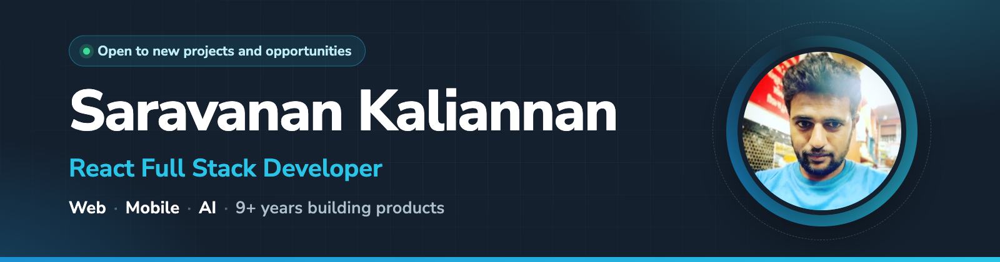

  

  <a href="https://saravanank.in"><b>Portfolio</b></a> &nbsp;·&nbsp;
  <a href="https://linkedin.com/in/saravanankofficial"><b>LinkedIn</b></a> &nbsp;·&nbsp;
  <a href="mailto:k.saravananoct25@gmail.com"><b>Email</b></a>

## About

I build web and mobile products end to end: responsive **React and Next.js** interfaces, **Node.js** APIs, and cloud deployment.
With **9+ years** of experience, I've delivered e-commerce, enterprise and real-time products for global clients including
**Chewy** and **P&G**, and I build AI features with **LLMs and Claude**. Based in Coimbatore, India.

## What I work with

| Area | Tools |
|---|---|
| **Frontend** | `React.js` `Next.js` `Redux` `React Native` `TypeScript` `Gatsby` `Tailwind CSS` `Material UI` `Ant Design` |
| **Backend & data** | `Node.js` `Express.js` `Nest.js` `MySQL` `PostgreSQL` `Sequelize` `Strapi` `GraphQL` |
| **Cloud & tools** | `AWS` `GCP` `Git` `PM2` `Figma` `Jest` `WebRTC` `Socket.io` `Razorpay` `Stripe` |
| **AI** | `LLM integration` `Claude` `Anthropic API` |

## Featured work

| Product | What it is |
|---|---|
| **[productlink.in](https://productlink.in)** | Link-in-bio and online store for Indian creators: Instagram DM and comment auto-reply, AI answers to product questions, UPI and card checkout. Android and iOS apps. |
| **[Platozo](https://platozo.com)** | Commission-free online ordering for home and cloud kitchens, with a partner app on Google Play. |
| **[Oneplexo](https://oneplexo.com)** | My digital product and AI engineering studio in Coimbatore, building websites, apps and AI for businesses. |

## Career highlights

- **Cognizant** (2024 – present): Senior Associate on the Chewy.com notification area, with React, Redux and Next.js.
- **LTIMindtree** (2022 – 2024): built the P&G Mixture incentive and coupon management platform. Received a Team Player Award.
- **Real-time chat** with WebRTC and Socket.io, in production with 500+ active users.

## Get in touch

I'm open to discussing new projects and opportunities. The best way to reach me is
[email](mailto:k.saravananoct25@gmail.com) or [LinkedIn](https://linkedin.com/in/saravanankofficial).
